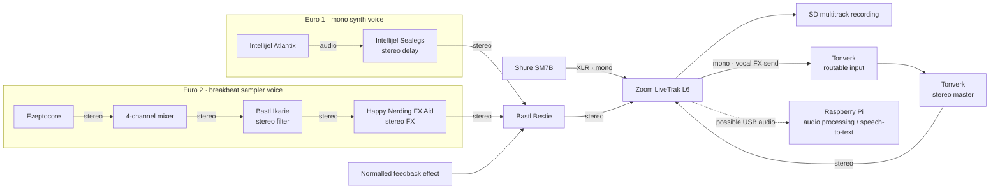
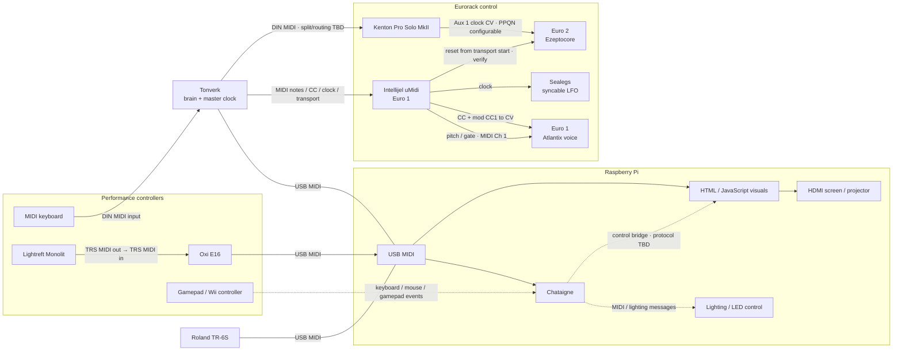

# Audio and MIDI connections

Status: working draft derived from the notes captured on 8 October 2026, with
MIDI wiring updated on 28 October 2026.

This document is the canonical overview of audio, MIDI, clock, control, and
visual routing in the TDA live setup. The untouched input is preserved in
[the dated source notes](source-notes/audio-midi-2026-10-08.txt).

Solid lines and arrows below represent current wiring or a stated requirement.
Dotted arrows represent proposed, optional, or unverified paths. A solid
connection can still have an explicit verification note where the physical
connection is known but its behaviour needs testing.

## Audio routing

Exact mixer-channel assignments remain in the source notes. The Bestie feedback
path is musically useful but changes the overall gain, so a repeatable way to
control its level remains an open performance-design problem.

## MIDI, clock, control, and visuals

## Device roles and current assignments

| Device | Current or intended role |
| --- | --- |
| Tonverk | Central musical brain, sequencer, and master clock; receives the MIDI keyboard through its hardware DIN input and connects to the Raspberry Pi by USB MIDI; provides stereo master audio |
| Lightreft Monolit | Performance MIDI controller; TRS MIDI output connects to the Oxi E16 input |
| Oxi E16 | Performance MIDI controller and Lua-capable translator for CC and SysEx; receives Monolit TRS MIDI and connects to the Raspberry Pi by USB MIDI |
| Roland TR-6S | Connects to the Raspberry Pi by USB MIDI |
| Kenton Pro Solo MkII | Converts MIDI clock to stable PPQN clock CV for Euro 2; spare aux outputs may later provide standardised CC-to-CV modulation |
| Intellijel uMidi | Converts Tonverk MIDI to pitch, gate, clock, modulation, and reset signals for Euro 1 and Euro 2 |
| Euro 1 | Atlantix mono voice through Sealegs stereo delay into Bestie |
| Euro 2 | Ezeptocore through mixer, Ikarie, and FX Aid into Bestie |
| Bastl Bestie | Performance submixer for both Eurorack voices and its normalled feedback effect |
| Zoom L6 | Main mixer, vocal input, stereo returns from Bestie and Tonverk, optional multitrack recorder, and possible Pi audio interface |
| Raspberry Pi | USB MIDI host for E16, Tonverk, and TR-6S; runs Chataigne and browser visuals; outputs HDMI; potential audio analysis, speech-to-text, and lighting control host |

## Decisions and verification still needed

1. Define how Tonverk's MIDI output is split or routed to both uMidi and the
   Kenton.
2. Identify the installed Intellijel uMidi hardware/firmware version and the
   applicable updater or configuration application.
3. Verify that Tonverk's MIDI transport-start message reliably produces the
   intended reset CV from uMidi to Ezeptocore.
4. Record the Kenton clock division/PPQN setting and confirm whether the clock
   output described as `clock CV out` and `Aux 1` is the same configured output.
5. Confirm Zoom L6 USB audio capabilities in the intended Raspberry Pi
   operating mode, including the available channel count.
6. Verify how MIDI from the Monolit passes through the E16 to the Raspberry Pi.
7. Decide how Chataigne communicates with the browser visuals and lighting
   system: MIDI, OSC, WebSocket, standard lighting protocols, or a combination.
8. Design a repeatable gain strategy for the Bestie feedback effect and the
   Zoom L6 vocal-to-Tonverk effects loop.
