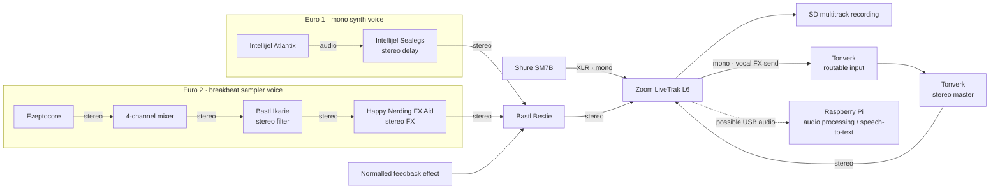

# Audio and MIDI connections

<<<<<<< Updated upstream
Status: working draft derived from the notes captured on 8 October 2026, with
MIDI wiring updated on 28 October 2026.
=======
Status: working draft updated with confirmed physical connections on 25 October
2026.
>>>>>>> Stashed changes

This document is the canonical overview of audio, MIDI, clock, control, and
visual routing in the TDA live setup. The original input is preserved in
[the 8 October source notes](source-notes/audio-midi-2026-10-08.txt), with the
newly confirmed wiring recorded in
[the 25 October source notes](source-notes/audio-midi-2026-10-25.txt).
The current Pi routing implementation is clarified in
[the ALSA router source note](source-notes/alsa-midi-router-2026-10-25.txt).
The E16's current TR-6S translation role is clarified in
[the E16 Lua source note](source-notes/e16-lua-tr6s-routing-2026-10-25.txt).

The open design for changing TR-6S patterns once per Tonverk song is documented
separately in
[Tonverk song changes and TR-6S pattern selection](tonverk-tr6s-song-pattern-sync.md).

Solid lines and arrows below represent current wiring or a stated requirement.
Dotted arrows represent proposed, optional, or unverified paths. A solid
connection can still have an explicit verification note where the physical
connection is known but its behaviour needs testing.

## Audio routing



Exact mixer-channel assignments remain in the source notes. The Bestie feedback
path is musically useful but changes the overall gain, so a repeatable way to
control its level remains an open performance-design problem.

## MIDI, clock, control, and visuals

```mermaid
flowchart LR
    subgraph CONTROLLERS["Performance controllers"]
        KEYBOARD["MIDI keyboard"]
<<<<<<< Updated upstream
        MONOLIT["Lightreft Monolit"]
        E16["Oxi E16"]
=======
        MONOLIT["Lightreft Monolit<br/>TRS-A MIDI / USB host"]
        E16["Oxi E16<br/>USB/TRS-A + Lua<br/>CC → TR-6S SysEx"]
>>>>>>> Stashed changes
        GAMEPAD["Gamepad / Wii controller"]
    end

    TONVERK["Tonverk<br/>brain + master clock"]
    TR6S["Roland TR-6S"]

    subgraph EURO_CONTROL["Eurorack control"]
        UMIDI["Intellijel MIDI 1U<br/>Euro 1"]
        EURO1_VOICE["Euro 1<br/>Atlantix voice"]
        SEALEGS_CLOCK["Sealegs<br/>syncable LFO"]
        KENTON["Kenton Pro Solo MkII"]
        EZE_CONTROL["Euro 2<br/>Ezeptocore"]

        UMIDI -->|"pitch / gate · MIDI Ch 1"| EURO1_VOICE
        UMIDI -->|"CC + mod CC1 to CV"| EURO1_VOICE
        UMIDI -->|clock| SEALEGS_CLOCK
        UMIDI -->|"reset from transport start · verify"| EZE_CONTROL
        KENTON -->|"Aux 1 clock CV · PPQN configurable"| EZE_CONTROL
    end

    subgraph PI["Raspberry Pi"]
<<<<<<< Updated upstream
        PI_MIDI["USB MIDI"]
=======
        PI_USB["USB device connections"]
        ALSA_ROUTER["ALSA sequencer router<br/>aconnect + polling service"]
>>>>>>> Stashed changes
        CHATAIGNE["Chataigne"]
        VISUALS["HTML / JavaScript visuals"]
        LIGHTING["Lighting / LED control"]
        HDMI["HDMI screen / projector"]

        PI_USB --> ALSA_ROUTER
        PI_USB -.->|"optional future input"| CHATAIGNE
        PI_USB -.->|"browser input routing · verify"| VISUALS
        CHATAIGNE -.->|"MIDI / lighting messages"| LIGHTING
        CHATAIGNE -.->|"control bridge · protocol TBD"| VISUALS
        VISUALS --> HDMI
    end

<<<<<<< Updated upstream
    KEYBOARD -->|"DIN MIDI input"| TONVERK
    MONOLIT -->|"TRS MIDI out → TRS MIDI in"| E16
    E16 -->|"USB MIDI"| PI_MIDI
    TONVERK ---|"USB MIDI"| PI_MIDI
    TR6S ---|"USB MIDI"| PI_MIDI
    TONVERK -->|"MIDI notes / CC / clock / transport"| UMIDI
    TONVERK -->|"DIN MIDI · split/routing TBD"| KENTON

=======
    KNOT["Intech Studio Knot<br/>USB MIDI host · TRS-A I/O"]
    L6_MIDI["Zoom L6<br/>TRS-A MIDI + USB MIDI"]
    TR6S["Roland TR-6S"]

    KEYBOARD -->|"notes"| CME_U6
    MONOLIT -->|"MIDI CC"| CME_U6
    CME_U6 -->|"merged MIDI"| TONVERK
    E16 -->|"TRS-A MIDI"| KENTON
    KENTON -->|"MIDI THRU"| UMIDI

    MONOLIT -.->|"optional USB MIDI"| KNOT
    E16 -.->|"optional USB MIDI"| KNOT
    GAMEPAD -.->|"optional USB host input"| KNOT
    KNOT -.->|"alternative TRS-A MIDI route"| CME_U6

    TONVERK -->|"USB · connected"| PI_USB
    E16 -->|"USB · connected"| PI_USB
    TR6S -->|"USB · connected"| PI_USB
    MONOLIT -.->|"USB MIDI? · verify"| PI_USB
    L6_MIDI -.->|"USB MIDI route · verify"| PI_USB
>>>>>>> Stashed changes
    GAMEPAD -.->|"keyboard / mouse / gamepad events"| CHATAIGNE
```

The active [`pi-midi-router`](https://github.com/LeaveTheCapital/pi-midi-router)
configuration routes Tonverk to both the E16 and TR-6S, and routes the E16 to
the TR-6S. The E16 runs the
[`tr6s-sysex.lua`](https://github.com/LeaveTheCapital/oxi-e16-lua-scripts/blob/main/tr6s-sysex.lua)
script, which translates selected MIDI CC messages into Roland TR-6S SysEx.
Implementation details and the parameter map remain in the
[`oxi-e16-lua-scripts`](https://github.com/LeaveTheCapital/oxi-e16-lua-scripts)
repository.

## Device roles and current assignments

| Device | Current or intended role |
| --- | --- |
<<<<<<< Updated upstream
| Tonverk | Central musical brain, sequencer, and master clock; receives the MIDI keyboard through its hardware DIN input and connects to the Raspberry Pi by USB MIDI; provides stereo master audio |
| Lightreft Monolit | Performance MIDI controller; TRS MIDI output connects to the Oxi E16 input |
| Oxi E16 | Performance MIDI controller and Lua-capable translator for CC and SysEx; receives Monolit TRS MIDI and connects to the Raspberry Pi by USB MIDI |
| Roland TR-6S | Connects to the Raspberry Pi by USB MIDI |
| Kenton Pro Solo MkII | Converts MIDI clock to stable PPQN clock CV for Euro 2; spare aux outputs may later provide standardised CC-to-CV modulation |
| Intellijel uMidi | Converts Tonverk MIDI to pitch, gate, clock, modulation, and reset signals for Euro 1 and Euro 2 |
| Euro 1 | Atlantix mono voice through Sealegs stereo delay into Bestie |
| Euro 2 | Ezeptocore through mixer, Ikarie, and FX Aid into Bestie |
| Bastl Bestie | Performance submixer for both Eurorack voices and its normalled feedback effect |
| Zoom L6 | Main mixer, vocal input, stereo returns from Bestie and Tonverk, optional multitrack recorder, and possible Pi audio interface |
| Raspberry Pi | USB MIDI host for E16, Tonverk, and TR-6S; runs Chataigne and browser visuals; outputs HDMI; potential audio analysis, speech-to-text, and lighting control host |

## Decisions and verification still needed

1. Define how Tonverk's MIDI output is split or routed to both uMidi and the
   Kenton.
2. Identify the installed Intellijel uMidi hardware/firmware version and the
=======
| CME U6 MIDI Pro | Merges keyboard and Monolit MIDI before Tonverk; its remaining input and exact output assignments need confirmation |
| Tonverk | Central musical brain, sequencer, and master clock; connected to the Raspberry Pi by USB and provides stereo master audio |
| Lightreft Monolit | Performance MIDI controller; intended to control Tonverk and potentially host a gamepad |
| Oxi E16 | Performance controller and active Lua processor between Tonverk and the TR-6S; translates selected MIDI CC messages into TR-6S SysEx; connected by USB to the Pi and by TRS-A MIDI to the Kenton |
| Roland TR-6S | Drum machine connected to the Pi by USB; currently receives routed Oxi E16 and Tonverk MIDI, with one-pattern-per-Tonverk-song automation under design |
| Kenton Pro Solo MkII | Receives MIDI from the Oxi E16, passes it from MIDI THRU to the Intellijel MIDI 1U, and converts MIDI clock to stable PPQN clock CV for Euro 2; spare aux outputs may later provide standardised CC-to-CV modulation |
| Intellijel MIDI 1U | Receives MIDI from the Kenton MIDI THRU and converts it to pitch, gate, clock, modulation, and reset signals for Euro 1 and Euro 2 |
| Euro 1 | Atlantix mono voice through Sealegs stereo delay into Bestie |
| Euro 2 | Ezeptocore through mixer, Ikarie, and FX Aid into Bestie |
| Bastl Bestie | Performance submixer for both Eurorack voices and its normalled feedback effect |
| Zoom L6 | Main mixer, vocal input, stereo returns from Bestie and Tonverk, optional multitrack recorder, and possible Pi audio/MIDI interface |
| Raspberry Pi | Runs the `pi-midi-router` ALSA polling service for current USB MIDI routing; Chataigne and browser visuals are potential future layers; outputs HDMI |
| Intech Studio Knot | Optional USB MIDI host and TRS-A routing utility |

## Decisions and verification still needed

1. Confirm the remaining CME U6 input/output assignments and whether its merged
   keyboard and Monolit output still feeds Tonverk as shown.
2. Identify the installed Intellijel MIDI 1U hardware/firmware version and the
>>>>>>> Stashed changes
   applicable updater or configuration application.
3. Verify whether transport start in the Oxi E16 MIDI stream, passed through
   the Kenton, reliably produces the intended reset CV for Ezeptocore.
4. Record the Kenton clock division/PPQN setting and confirm whether the clock
   output described as `clock CV out` and `Aux 1` is the same configured output.
5. Confirm Zoom L6 USB audio capabilities in the intended Raspberry Pi
   operating mode, including the available channel count.
<<<<<<< Updated upstream
6. Verify how MIDI from the Monolit passes through the E16 to the Raspberry Pi.
7. Decide how Chataigne communicates with the browser visuals and lighting
=======
6. Verify the subscriptions configured by `pi-midi-router` against the live
   ALSA graph while all devices are connected, and determine whether a powered
   hub is required.
7. Verify whether Monolit's USB-C port carries MIDI and decide whether its USB-A
   host port or the Knot should host game controllers.
8. Decide how Chataigne communicates with the browser visuals and lighting
>>>>>>> Stashed changes
   system: MIDI, OSC, WebSocket, standard lighting protocols, or a combination.
8. Design a repeatable gain strategy for the Bestie feedback effect and the
   Zoom L6 vocal-to-Tonverk effects loop.
