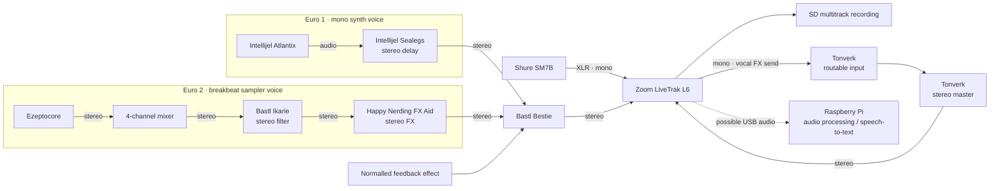

# Audio and MIDI connections

Status: working draft based on the dated physical-connection notes and current Pi repository. Unverified paths are marked below.

This document is the canonical overview of audio, MIDI, clock, control, and
visual routing in the TDA live setup. The original input is preserved in
[the 8 October source notes](source-notes/audio-midi-2026-10-08.txt), with the
newly confirmed wiring recorded in
[the 25 October source notes](source-notes/audio-midi-2026-10-25.txt).
The current Pi routing and TR-6S translation implementation is in the
[Pi router repository](https://github.com/LeaveTheCapital/pi-midi-router).
The [ALSA router note](source-notes/alsa-midi-router-2026-10-25.txt) and
[E16 Lua note](source-notes/e16-lua-tr6s-routing-2026-10-25.txt) preserve the
earlier setup.

The open design for changing TR-6S patterns once per Tonverk song is documented
separately in
[Tonverk song changes and TR-6S pattern selection](tonverk-tr6s-song-pattern-sync.md).

Solid lines and arrows below represent current wiring or a stated requirement.
Dotted arrows represent proposed, optional, or unverified paths. A solid
connection can still have an explicit verification note where the physical
connection is known but its behaviour needs testing.

## Audio routing

Exact mixer-channel assignments remain in the source notes. The Bestie feedback
path is musically useful but changes the overall gain, so a repeatable way to
control its level remains an open performance-design problem.

## MIDI, clock, control, and visuals

The dated notes confirm USB connections from Tonverk, Oxi E16, and TR-6S to
the Pi. They also confirm E16 TRS-A output to the Kenton and Kenton MIDI THRU
to Intellijel MIDI 1U. The Pi repository defines ALSA routing, including a
direct Tonverk → TR-6S path for clock and transport when sent. The Python TR-6S bridge receives control
messages and sends DT1 SysEx. Live service and subscription state still need
checking on the Pi.

~~~mermaid
flowchart LR
    subgraph CONTROLLERS["Performance controllers"]
        KEYBOARD["MIDI keyboard"]
        MONOLIT["Lightreft Monolit"]
        E16["Oxi E16"]
        GAMEPAD["Gamepad / Wii controller"]
    end

    TONVERK["Tonverk brain and master clock"]
    TR6S["Roland TR-6S"]
    CME_U6["CME U6 MIDI Pro proposed merge route"]

    subgraph EURO_CONTROL["Eurorack control"]
        UMIDI["Intellijel MIDI 1U Euro 1"]
        EURO1_VOICE["Euro 1 Atlantix voice"]
        SEALEGS_CLOCK["Sealegs syncable LFO"]
        KENTON["Kenton Pro Solo MkII"]
        EZE_CONTROL["Euro 2 Ezeptocore"]

        UMIDI -->|"pitch / gate · MIDI Ch 1"| EURO1_VOICE
        UMIDI -->|"CC and mod CC1 to CV"| EURO1_VOICE
        UMIDI -->|clock| SEALEGS_CLOCK
        UMIDI -->|"reset from transport start · verify"| EZE_CONTROL
        KENTON -->|"Aux 1 clock CV · PPQN configurable"| EZE_CONTROL
    end

    subgraph PI["Raspberry Pi"]
        PI_USB["USB MIDI device connections"]
        ALSA_ROUTER["ALSA sequencer router polling service"]
        PYTHON_BRIDGE["Python tr6s-sysex service CC / NRPN / note → DT1 SysEx"]
        CHATAIGNE["Chataigne · proposed"]
        VISUALS["HTML / JavaScript visuals"]
        LIGHTING["Lighting / LED control · proposed"]
        HDMI["HDMI screen / projector"]

        PI_USB --> ALSA_ROUTER
        PI_USB --> PYTHON_BRIDGE
        PI_USB -.->|"browser input · verify"| VISUALS
        PI_USB -.->|"optional future input"| CHATAIGNE
        CHATAIGNE -.->|"MIDI / lighting messages"| LIGHTING
        CHATAIGNE -.->|"control bridge · protocol TBD"| VISUALS
        VISUALS --> HDMI
    end

    KEYBOARD -.->|"input route · verify"| TONVERK
    MONOLIT -.->|"controller route · verify"| TONVERK
    KEYBOARD -.->|"proposed merge"| CME_U6
    MONOLIT -.->|"proposed merge"| CME_U6
    CME_U6 -.->|"proposed output"| TONVERK

    TONVERK -->|"USB MIDI"| PI_USB
    E16 -->|"USB MIDI"| PI_USB
    TR6S -->|"USB MIDI"| PI_USB
    E16 -->|"TRS-A MIDI"| KENTON
    KENTON -->|"MIDI THRU"| UMIDI

    ALSA_ROUTER -->|"Tonverk clock, transport, and MIDI"| TR6S
    ALSA_ROUTER -->|"Tonverk and E16 controls"| PYTHON_BRIDGE
    PYTHON_BRIDGE -->|"DT1 SysEx · USB MIDI 1"| TR6S
    GAMEPAD -.->|"keyboard / mouse / gamepad events"| CHATAIGNE
~~~

The [class-compliant Pi router](https://github.com/LeaveTheCapital/pi-midi-router/blob/main/router-class-compliant.sh)
maintains Tonverk → E16, Tonverk → TR-6S, E16 → Tonverk, and E16 → TR-6S
subscriptions. The [Python TR-6S service](https://github.com/LeaveTheCapital/pi-midi-router/tree/main/tr6s_sysex)
translates selected MIDI CC, NRPN, and note messages to Roland DT1 SysEx.
Its [parameter map](https://github.com/LeaveTheCapital/pi-midi-router/blob/main/tr6s-parameter-map.tsv)
and [hardware test plan](https://github.com/LeaveTheCapital/pi-midi-router/blob/main/test-plan.md)
live in the Pi repository. The earlier E16 TR-6S Lua translator is retired for
this path; the Pi router defaults its E16 Lua autoload mode to off.

## Device roles and current assignments

| Device | Current or intended role |
| --- | --- |
| Tonverk | Central musical brain and master clock; connected to the Pi by USB MIDI and audio |
| Oxi E16 | Performance controller; connected to the Pi by USB MIDI and to the Kenton by TRS-A MIDI; sends controls consumed by the Pi Python bridge |
| Roland TR-6S | Drum machine connected to the Pi by USB; receives direct routed MIDI and Python bridge SysEx |
| Raspberry Pi | Hosts the ALSA polling router and Python TR-6S bridge; deployment and live service state need checking |
| Kenton Pro Solo MkII | Receives E16 TRS-A MIDI, passes MIDI THRU to Intellijel MIDI 1U, and supplies clock CV to Euro 2 |
| Intellijel MIDI 1U | Converts Kenton MIDI THRU input to pitch, gate, clock, modulation, and reset signals |
| Euro 1 | Atlantix through Sealegs into Bestie |
| Euro 2 | Ezeptocore through mixer, Ikarie, and FX Aid into Bestie |
| Bastl Bestie | Performance submixer for both Eurorack voices and feedback effect |
| Zoom L6 | Main mixer, vocal input, stereo returns from Bestie and Tonverk; possible future Pi audio interface |
| Lightreft Monolit, MIDI keyboard, CME U6 | Exact current controller and merge wiring needs verification against the rig |
| Intech Studio Knot | Optional USB MIDI host and TRS-A routing utility |

## Decisions and verification still needed

1. Confirm the installed Pi services, E16 Lua autoload setting, and live ALSA subscriptions with all three USB devices connected.
2. Confirm the keyboard, Monolit, and CME U6 physical routes; the dated notes describe both direct and proposed merged routes.
3. Test whether transport start through Intellijel MIDI 1U produces the intended Ezeptocore reset CV.
4. Record Kenton clock division and whether the described clock CV output is Aux 1.
5. Confirm Zoom L6 USB audio capabilities in the intended Pi mode.
6. Test [Tonverk song cues and TR-6S pattern selection](tonverk-tr6s-song-pattern-sync.md), including the website's overlapping channel 10 note mapping.
7. Decide whether Chataigne, lighting, or a browser bridge is needed for the performance.
8. Design repeatable gain control for Bestie feedback and the L6 vocal effects loop.
