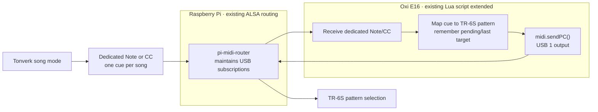

# Tonverk song changes and TR-6S pattern selection

Status: design proposal; current behaviour is recorded, but the proposed
solutions still need testing on the live rig.

This note describes ways to change the Roland TR-6S pattern once when Tonverk
changes songs without letting every Tonverk pattern change disturb the drum
machine. The original problem report is preserved in
[the dated source note](source-notes/tonverk-tr6s-song-pattern-sync-2026-10-25.txt).
The current routing implementation is recorded in
[the ALSA router source note](source-notes/alsa-midi-router-2026-10-25.txt).
The existing E16 translation layer is recorded in
[the E16 Lua source note](source-notes/e16-lua-tr6s-routing-2026-10-25.txt).

## Goal and observed problem

The desired behaviour is one automatic TR-6S pattern selection at each Tonverk
song change. The following behaviour has been observed:

- Tonverk's global program-change output sends a message whenever its pattern
  changes. A Tonverk song normally contains several pattern changes, so this is
  too frequent to use directly as a song-change signal.
- A program change placed as a parameter lock on a Tonverk MIDI-machine trig
  can target a particular point in the arrangement, but the attempted setup
  disturbed synchronisation.
- Program change over DIN MIDI has not yet been tested.
- Tonverk and the TR-6S are both physically connected to the Raspberry Pi by
  USB. The Pi currently routes them with ALSA sequencer subscriptions maintained
  by a boot-time polling service; Chataigne is not in use.
- Tonverk is also routed through the Oxi E16 to the TR-6S. The E16 is already
  running custom Lua that translates selected MIDI CC messages into Roland
  TR-6S SysEx.

It is not yet confirmed whether synchronisation is disturbed by the timing of
the TR-6S pattern switch, duplicate clock or transport routes, a MIDI feedback
loop, or the timing of the Tonverk parameter-locked message. DIN and USB carry
the same MIDI Program Change message, but their routing and timing can differ;
the DIN result should therefore be measured rather than assumed.

## Confirmed device behaviour

- Tonverk `PROG CH SEND` sends a program change whenever its pattern changes.
  Its MIDI port configuration can send to USB, DIN MIDI, or both, and its
  program-change output channel is configurable. See the
  [Tonverk user manual, section 17.2](https://www.elektron.se/wp-content/uploads/2026/05/Tonverk-User-Manual_ENG_OS1.3.3_260507.pdf).
- A Tonverk song is an arrangement of pattern rows; it can contain up to 99
  rows. The manual does not document a separate outbound MIDI event for a song
  change.
- The TR-6S can receive Program Change 0–127. It can also receive MIDI clock,
  Start, Continue, and Stop, but it does not receive MIDI Song Position. See
  the [TR-6S MIDI implementation chart](https://static.roland.com/assets/media/pdf/TR-6S_MIDIImpleChart_eng02_W.pdf).
- The TR-6S provides `Rx Prog Chg`, `Pattern Ch`, `TempoSync`, `RxStartStop`,
  `USBMidiThru`, and `Soft Thru` settings. If `TempoSync` is `AUTO` and clock is
  present on USB and DIN simultaneously, USB has priority. See the
  [TR-6S parameter guide](https://static.roland.com/assets/media/pdf/TR-6S_Parameter_eng02_W.pdf)
  and [Roland's clock-source instructions](https://support.roland.com/hc/en-us/articles/56978104735643-TR-6S-How-do-I-synchronize-the-tempo-with-a-DAW-or-an-external-MIDI-device).
- ALSA's `aconnect` connects one sequencer port to another and redirects the
  whole event stream. ALSA requires a sequencer client to process or modify
  individual events. See the [`aconnect` manual](https://manpages.debian.org/bookworm/alsa-utils/aconnect.1.en.html)
  and the [ALSA sequencer filter example](https://www.alsa-project.org/alsa-doc/alsa-lib/seq.html).
- The E16 Lua API can receive Note and CC callbacks, send Program Change with
  `midi.sendPC()`, send SysEx, and receive clock/transport callbacks. It cannot
  deliver incoming Program Change messages to Lua. Incoming messages also
  continue through the E16 firmware's normal MIDI Thru path unless MIDI Thru is
  disabled. See the
  [E16 Lua API guide](https://github.com/LeaveTheCapital/oxi-e16-lua-scripts/blob/main/OXI_E16_Lua_API_Guide.md).

## Current Pi implementation

The current implementation lives in the
[pi-midi-router repository](https://github.com/LeaveTheCapital/pi-midi-router),
not in this project-level repository. On the Pi, `midi-router.service` starts
`/home/hellohenry/pi-midi-router/router.sh`. The service is enabled and active.
The script polls the ALSA graph once per second, discovers clients by name, and
recreates these whole-port subscriptions when devices reconnect:

- Oxi E16 → TR-6S
- Oxi E16 → Tonverk
- Tonverk → TR-6S
- Tonverk → Oxi E16
- Available Oxi E16 ports → ALSA `Midi Through`

The E16 runs
[`tr6s-sysex.lua`](https://github.com/LeaveTheCapital/oxi-e16-lua-scripts/blob/main/tr6s-sysex.lua).
It currently listens for Notes and CCs on MIDI channels 11 and 12, uses a
channel-11 Note On to select the kit address, and converts mapped CC values into
Roland DT1 SysEx. Its output setting is currently `0`, meaning all E16 outputs.

The polling shell script does not read individual MIDI events. In particular,
this line creates a direct unfiltered subscription:

```bash
route "$tonverk_client" 0 "$tr6s_client" 0
```

Therefore the existing script cannot distinguish a Tonverk song-entry pattern
from any other pattern, suppress selected Program Change messages, change their
values, or remember the last TR-6S target. `aconnect` alone cannot implement the
proposed stateful solution.

## Recommended design: extend the E16 Lua translator

Keep the existing ALSA subscriptions and extend the Lua script already running
on the E16. Instead of sending a direct Program Change parameter lock, Tonverk
sends one otherwise-unused Note or CC as a song cue. E16 Lua receives that cue,
maps it to the required TR-6S pattern, and calls `midi.sendPC()` once.



Place one dedicated cue in the first pattern of every Tonverk song, or in the
last pattern of the outgoing song if testing shows the TR-6S must be pre-cued.
The Lua script holds a table such as:

| Example Tonverk cue | Meaning | TR-6S target |
| --- | --- | --- |
| Ch 13 · CC 110 · value 1 | Song 1 begins | Pattern 1-01 |
| Ch 13 · CC 110 · value 2 | Song 2 begins | Pattern 2-01 |
| Ch 13 · CC 110 · value 3 | Song 3 begins | Pattern 3-01 |

The cue channel and controller above are examples; choose values that the TR-6S
ignores and that do not overlap the existing E16 mappings. The actual song map
must be filled in from the set list. MIDI Program Change is encoded from 0 to
127 while device screens commonly number items from 1; verify the offset with
two harmless test patterns before entering the complete map.

The Lua extension should:

1. Listen for song cues on a dedicated MIDI channel that does not conflict with
   the existing channel 11/12 TR-6S parameter mappings.
2. Match only the configured song cue Note or CC values.
3. Convert each cue to the chosen TR-6S pattern number and channel.
4. Suppress an output if it is the same TR-6S target already selected. This
   prevents an unnecessary reload when a Tonverk song loops to its first row.
5. Use E16 output `3` for USB 1 rather than output `0` (`All outputs`) unless
   the Program Change genuinely needs to reach the TRS and Bluetooth outputs.
6. Keep the callback short. If boundary scheduling is needed, store a pending
   target and send it from `clock.onPulse()` at the chosen boundary.

Turn Tonverk's global `PROG CH SEND` off, or put it on a channel the TR-6S
ignores, so its ordinary pattern changes cannot select TR-6S patterns. Because
E16 Lua cannot receive Program Change callbacks, it must receive a Note or CC
cue from the Tonverk MIDI machine instead. E16 input callbacks report channel
numbers 1–16, while the send-function examples use zero-based channel values
(`0` sends on MIDI channel 1). Verify this offset with a harmless test.

The cue itself still follows normal E16 MIDI Thru and the direct Tonverk → TR-6S
route. Choose a cue channel/message that the TR-6S ignores, or remove the direct
route if testing proves that necessary. The generated Program Change then
travels over the existing E16 → TR-6S ALSA subscription.

## Alternative: ALSA song-boundary filter client

If the E16 solution cannot schedule the change reliably, add a persistent ALSA
sequencer client in the
[pi-midi-router repository](https://github.com/LeaveTheCapital/pi-midi-router).
It would replace the direct Tonverk → TR-6S subscription, pass required clock
and transport events, and perform the same cue mapping. The polling shell script
can continue handling discovery and reconnects. Do not parse `aseqdump` output
in a shell loop for live clock routing; use the ALSA sequencer API intended for
filter clients.

## Pattern-change timing strategies

Disabling or isolating Tonverk's automatic Program Changes solves the
excessive-message problem, but the remaining E16-generated Program Change must
still be timed safely. Test these strategies in order.

### 1. Change while stopped

If songs are selected between performances, send the TR-6S Program Change
while both sequencers are stopped, then start them from the same Tonverk
transport event. This is the simplest and most reliable option.

### 2. Pre-cue before the song boundary

For a continuous set, place the cue in the final Tonverk pattern of the outgoing
song and let the E16 send the next TR-6S selection early enough to queue at the
intended boundary. This requires testing the TR-6S's switch timing. Do not use
this until it is confirmed that preselecting a pattern does not switch it
immediately.

### 3. Targeted Stop → Program Change → Start

If a live Program Change leaves the TR-6S out of phase, send Stop only to the
TR-6S, select its new pattern, and send Start on a known Tonverk bar boundary.
This deliberately restarts the TR-6S at step one without stopping Tonverk or
the modular clock. It may create an audible gap, so test it inside a transition
or muted bar. This is more deterministic than attempting to make the TR-6S
chase position because the TR-6S does not receive MIDI Song Position.

## Other possible solutions

### Use channel separation with the existing router

This is the only mostly automatic option available without an event-processing
client. Put Tonverk's automatic pattern-change messages on a channel different
from the TR-6S `Pattern Ch`, then send the song-boundary Program Change from a
MIDI machine on the TR-6S channel. `aconnect` still forwards everything, but the
TR-6S ignores the unwanted channel. This should be tested because the direct
parameter-locked Program Change has already disturbed sync; channel separation
does not fix the TR-6S's pattern-switch timing if that is the root cause.

### Make the Pi or Oxi E16 the set-list controller

Keep a `current song` control in the E16 Lua script. One encoder or button press
selects the mapped TR-6S pattern and arms the corresponding Tonverk song. This
is not fully automatic, and Tonverk has no documented MIDI command for selecting
a song, but it provides an explicit recovery control.

### Mirror every Tonverk pattern on the TR-6S

Arrange the TR-6S's 128 patterns so every Tonverk pattern number selects an
appropriate corresponding drum pattern. Duplicate TR-6S patterns where several
Tonverk patterns belong to one song. This uses Tonverk's native program-change
output with no translator logic, but creates substantial duplication and does
not help if any live Program Change itself causes the phase error.

### Separate clock and pattern-selection transports

Send clock and transport over one path and Program Change over another—for
example, DIN for clock and USB for selection. On the TR-6S, set `TempoSync`
explicitly to the clock path rather than `AUTO`. This can eliminate accidental
clock-source switching, but it needs an available DIN output or MIDI interface
and does not guarantee different internal pattern-change timing.

## Proposed initial configuration

| Device | Setting | Proposed value |
| --- | --- | --- |
| Tonverk | Clock Send | On |
| Tonverk | Transport Send | Currently Off; enable only if the chosen strategy requires it |
| Tonverk | Prog Ch Send | Off for the E16 cue design, or an ignored channel |
| Tonverk | Output To | USB, unless another documented route is required |
| Tonverk | Prog Chg Out Ch | Dedicated channel chosen for this route |
| TR-6S | TempoSync | USB while receiving Pi-routed USB clock |
| TR-6S | RxStartStop | On |
| TR-6S | Rx Prog Chg | On |
| TR-6S | Pattern Ch | Same channel used by the Pi's mapped output; verify |
| TR-6S | Sync Out | Off |
| TR-6S | USBMidiThru | Off unless a deliberate onward route requires it |
| TR-6S | Soft Thru | Off unless a deliberate DIN onward route requires it |
| Oxi E16 Lua | MIDI listen | Dedicated song-cue channel plus existing channels 11/12 |
| Oxi E16 Lua | Program Change output | USB 1 (`midi.sendPC()` output 3) |

The exact current settings are not yet recorded. Do not change all settings at
once during diagnosis; capture the existing values first.

## Test plan

1. Record the current Tonverk, E16, and TR-6S MIDI settings and capture
   `aconnect -l`. Retain only the Tonverk → E16 → TR-6S cue path and the single
   intended clock path for the focused test.
2. Capture the Tonverk USB MIDI stream during two pattern changes and one song
   change. Confirm the program-change channel, values, clock continuity, and
   whether Start or Stop is repeated unexpectedly.
3. Capture the Oxi USB output during the same test and confirm whether Tonverk
   Program Change or clock is echoed through the Oxi to the TR-6S route.
4. Confirm the live E16 Lua script still translates a known channel 11/12 CC
   into exactly one TR-6S SysEx message.
5. With the TR-6S stopped, send two dedicated Tonverk Note/CC cues through the
   E16 and record which displayed patterns are selected. This establishes the
   cue map, output, channel, and Program Change numbering.
6. Run both devices from one clock route and send one E16-generated change at
   a bar boundary. Record whether the TR-6S changes immediately or queues the
   next pattern, and whether its first step stays aligned.
7. Repeat the test one bar early, then repeat with the targeted
   Stop → Program Change → Start sequence.
8. Test DIN separately only after the USB baseline is recorded. Force
   `TempoSync` to the intended input so `AUTO` cannot switch sources.
9. Run the completed E16 cue mapping through complete songs, including loops and
   repeated selections. Use an ALSA filter client only if E16 timing is inadequate.

## Acceptance criteria

- Selecting or entering a Tonverk song causes exactly one intended TR-6S
  pattern selection.
- Ordinary Tonverk pattern changes inside the song cause no TR-6S selection.
- The TR-6S remains on the same beat and step phase for the whole song.
- No duplicate clock, transport, or feedback path exists.
- Stopping and restarting the set recovers deterministically without manually
  reselecting the TR-6S pattern.
